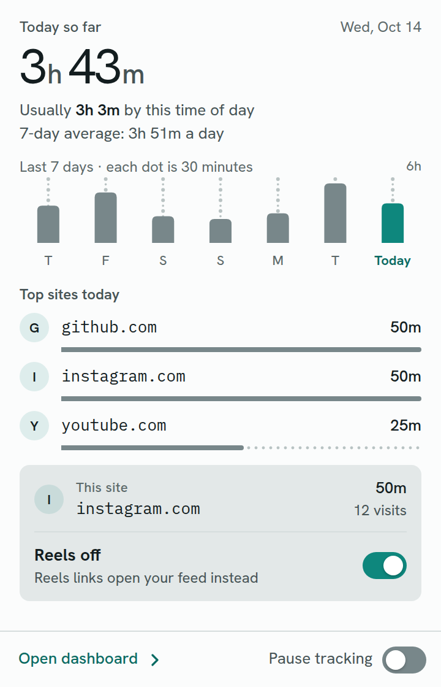
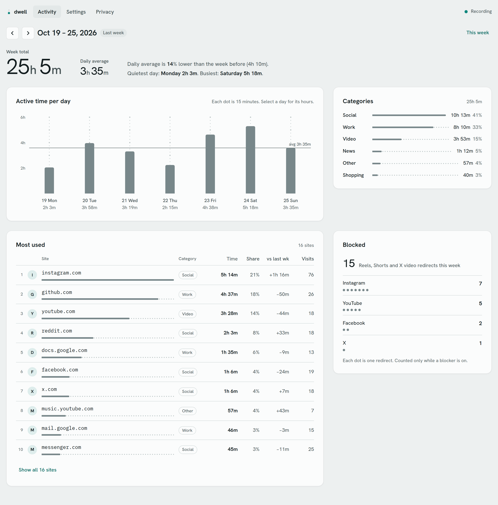

# Dwell

Screen time for websites, counted the way a person would count it, kept entirely in your browser.

<p>
  
  &nbsp;
  
</p>

More screenshots: [popup, dark](docs/screenshots/popup-dark.png), [week, dark](docs/screenshots/dashboard-week-dark.png), [one day](docs/screenshots/dashboard-day-light.png), [settings](docs/screenshots/dashboard-settings-light.png), [privacy](docs/screenshots/dashboard-privacy-light.png). They are made from simulated data by `npm run screenshots`.

## What it counts

A second goes to a site only when a Chrome window has focus, the site is in that window's active tab, and you are present. Present means Chrome's idle detector has seen input within your idle threshold (30, 60, 120 or 300 seconds; 60 by default), or, with the media setting on, that the tab in front is playing video or audio; a locked screen always stops the count, whatever is playing. Playing is reported by a small script on Instagram, YouTube, Facebook and X, and taken from Chrome's audible flag everywhere else, with a 30-second hold so a gap between two songs does not count as leaving. After any gap with no events longer than 90 seconds (sleep, a closed lid, the service worker being stopped), at most one minute is given to the site that was in front before the gap, and the state is rebuilt from the live browser. A visit is counted when a site becomes the counted site after at least 60 seconds of not being counted. Never counted: background tabs, unfocused windows, audio in either, incognito windows, `chrome://`, `file://` and other non-web pages, the new tab page, sites on your ignore list, and anything while tracking is paused.

## What it stores

For each local day: the registrable domain of each site (`youtube.com`, not the page), its seconds per hour, its visits, the number of Reels, Shorts and X video redirects per site, and your settings. Subdomains are grouped into their domain unless you list them as overrides. Never stored: full addresses, paths, queries, page titles, search terms, page content, form input, cookies. Days older than 90 are deleted once a day. Everything sits in this Chrome profile's extension storage, is not synced, and goes away when you remove Dwell or use Delete all data.

The event log is off by default. When you turn it on in Settings, Dwell keeps the last 24 hours of tracking events, each holding only a time, an event kind from a fixed list, a domain, Chrome's integer window and tab ids, and the audible flag. The ordinary data export never includes it; it has its own export button, described under [Replay a real day](#replay-a-real-day).

## One Reel at a time

The Reels, Shorts and X videos switches turn on one-video mode: you can open and watch the one Reel, Short or X video you tapped, but not scroll, swipe or arrow on to the next one. Search, posts and profiles keep working.

Two layers do the blocking. A guard script runs at `document_start` in the top frame of the four sites, in the extension's isolated world. It listens to the Navigation API and cancels an in-page navigation to a blocked address before it commits. A single Short or Instagram Reel goes on to a page that plays only that video: `/shorts/<id>` becomes `/watch?v=<id>`, and Instagram's `/reel/<code>` or `/reels/<code>` (also under a profile) becomes the post page `/p/<code>/`, and X's video viewer `/<user>/status/<id>/video/<n>` (or `/i/status/<id>/video/<n>`) becomes the tweet page `/<user>/status/<id>`, which plays that video with the replies below and no feed of other videos. The Reels feeds (`/reels/` on Instagram, `/reel/` and `/reels/` on Facebook) and, optionally, Explore go to the site's home page; a profile's Reels grid loads like any other page. If a blocked address ever becomes current anyway, fallbacks (`popstate`, YouTube's `yt-navigate-finish`, a 250 ms check of the address) replace it, at most twice per tab in five seconds. Direct loads, such as a shared link or a typed address, are redirected by static `declarativeNetRequest` rules before any request leaves Chrome, for top-level page loads only (`main_frame`); a Reel embedded in another site's page is left alone.

Facebook has no single-video page, so a Facebook Reel opens in Facebook's own viewer, and the guard keeps that viewer to the one reel: a move to another reel is cancelled and the first one is loaded again. The same lock applies to any viewer the redirects did not leave, X's included: there a move to another tweet's video goes back to the first tweet's page. While a viewer is open, the guard also swallows the wheel, the arrow and page keys and touch moves that would advance it, unless they scroll a panel that can still scroll, such as the comments. It reads only the scroll position and the overflow and scroll-snap styles of the elements under the pointer, and keeps nothing.

Instagram Reels, YouTube Shorts, Facebook Reels and X videos each have their own switch, on by default; Instagram Explore is a fifth switch, off by default. The popup shows the switch for the site you are on: one tap, no confirmation. Redirects stay within the four sites, and every target comes from one allowlist in `src/blocker/targets.ts`. X is reached on `x.com` only: `twitter.com` and `www.x.com` redirect there on X's side before the page loads, and the rules apply once the address is on `x.com`. X needs an account, so its rules are tested against fixture pages, not the live site.

Settings and exports from before the X switch existed have no X entry; they read it as on, and keep every other value.

Small stylesheets also hide the Reels and Shorts links and shelves on Instagram, YouTube and Facebook (X has no such entry to hide). They are cosmetic: they depend on the sites' current markup, will lag behind redesigns, and a missed link is still caught by the guard or the redirect rules.

## Privacy, auditable

| Permission | Why |
|---|---|
| `tabs` | Reads the address of the tab in front so its time goes to the right domain; only the domain is kept. |
| `idle` | Stops the count after your idle threshold, and at once when the screen locks. |
| `storage` | Keeps your totals and settings in this Chrome profile. |
| `alarms` | Saves the running total once a minute and deletes days older than 90 once a day. |
| `declarativeNetRequest` | Sends Reels, Shorts and X video viewer addresses to a single-video page, and the Reels feeds home, before the page loads. |
| `https://` www, m and bare hosts of instagram.com, youtube.com, facebook.com, plus x.com (nine patterns) | Runs the guard, the media reporter and the hiders on those sites, top frame only, and lets the redirect rules act there. |

The manifest also sets `incognito: not_allowed`, declares no `externally_connectable` (no web page or other extension can message Dwell), no optional permissions and no `<all_urls>`. Dwell's own pages and service worker run under this content security policy:

```
default-src 'none'; script-src 'self'; style-src 'self'; img-src 'self' data:; font-src 'self'
```

`default-src 'none'` leaves no `connect-src`, so a `fetch` from the popup, the dashboard or the worker is refused by Chrome. Three checks back the claim that Dwell makes no network requests of its own:

1. `scripts/check-privacy.ts` (`npm run check:privacy`) rebuilds, greps every file in `dist/` for `fetch(`, `XMLHttpRequest`, `WebSocket`, `sendBeacon`, `importScripts(`, `eval(`, `new Function`, `new Image`, `EventSource`, `WebTransport`, `RTCPeerConnection`, `import(` and `window.open`, and compares the built manifest with the literal list in `scripts/manifest-rules.ts`: permissions, host patterns, CSP, content-script frames, rulesets. Vite's module-preload polyfill, which contains `fetch(`, is turned off for this reason.
2. `eslint.config.js` bans the same APIs in `src/`, plus computed access on `globalThis`, `self` and `window` (so `self['fe' + 'tch']` fails lint), dynamic `import()`, and `createElement` of `script`, `link` or `iframe`.
3. `tests/e2e/privacy.spec.ts` loads the built extension in Chromium and calls `fetch` from the service worker and from the dashboard: both are refused with a `connect-src` violation, and a remote image never loads. Its fourth test, `a full tracking and blocking session makes no request outside the fixture hosts and the four sites`, records every request during a scripted session and checks that extension pages and the worker reach only `chrome-extension:`, `data:` and `blob:`.

The service worker authorises every message by sender. The sender must be this extension. Extension pages (popup, dashboard) may send only `settings`, `pause`, `import`, `deleteAll` and `undoDelete`. A content script, recognised by its top-frame `https` tab on one of the nine hosts, may send only `media { playing }` and `blocked { site }`, and `blocked` only for the site it runs on. Every payload must have exactly the documented keys and types and is copied before use; no content-script message carries an address or a title.

Import treats the file as untrusted: at most 2 MB, 400 days, 500 sites a day and 500 entries per settings list; dates must be real `YYYY-MM-DD` days, sites must be hostnames, hours 0 to 23, seconds whole numbers from 0 to 3,600, visits and redirect counts whole numbers in range; unknown keys and `__proto__`, `constructor` or `prototype` anywhere reject the file; records are built on null-prototype objects; days outside the 90-day window are skipped and counted. The merge keeps the larger value everywhere, so importing the same file twice changes nothing, and it is written in one commit, so a rejected or failed import leaves your data as it was.

The word is auditable, not provable. The checks above show that the bundle contains no network API, that Chrome refuses the requests the tests try, and that a recorded session stays on the expected hosts. They cannot rule out every code path in every Chrome version, the content scripts run under each site's own policy rather than Dwell's, and a build you did not make yourself is only as good as its match with this source. Each claim can be checked against the code and the tests; none of them is a proof.

## Install (unpacked)

You need Node 22.13 or later and Chrome.

```bash
git clone https://github.com/GeckoKing9/dwell.git
cd dwell
npm ci --ignore-scripts
npm run build
```

Open `chrome://extensions`, turn on **Developer mode**, choose **Load unpacked** and select the `dist/` folder. Pin Dwell from the puzzle-piece menu to reach the popup.

Chrome derives an unpacked extension's id from the folder path, and the data belongs to that id: keep `dist/` where it is, and to update, pull, run `npm run build` again and press the reload arrow on Dwell's card. Chrome may remind you that a developer-mode extension is loaded; that is expected for an unpacked install.

Each release on GitHub attaches `dwell-<version>.zip` and `dwell-<version>.sha256.txt`, built by `.github/workflows/release.yml` from the tagged commit. The text file holds one SHA-256 per file inside the zip, so an unpacked copy, or later an installed store build, can be checked file by file with `sha256sum -c`. A store build will differ in `manifest.json`, to which the store adds its own fields, and in an added `_metadata/` folder.

## How it is tested

The counting rule lives in one pure reducer, `src/tracker/engine.ts`, which is what makes it testable without Chrome. `tests/support/oracle.ts` is a deliberately naive second model: it shares only the types with the engine, walks time one second at a time and asks the presence question at every step. fast-check generates event sequences (focus changes, tab switches, address changes, idle and lock, media, pause, ticks, gaps, clock jumps) and `tests/engine.sim.test.ts` requires the engine to equal the oracle on 2,000 sequences at one-second resolution and 500 at 100 ms, and to hold these invariants:

- never attributes more seconds than the wall-clock span
- attributes nothing while no Chrome window has focus
- attributes nothing while locked or paused, whatever the media
- attributes nothing while idle unless the active tab plays media and the override is on
- gives every interval to at most one site and never more than its length
- places every attribution in a local day and hour its own interval touches
- splits a continuous session at hour, midnight and DST boundaries without losing a second
- attributes at most one heartbeat across a gap longer than 1.5 heartbeats
- is deterministic: the same sequence twice gives identical buckets and state
- resumes from JSON-serialised state after any prefix with identical buckets
- counts a visit exactly when a site becomes counted after at least 60 s not counted
- keeps every attributed second an integer

`tests/engine.robustness.test.ts` adds duplicated, reordered, same-millisecond and dropped events and malformed input. Together the engine suites run 5,700 generated sequences, and the event-log round trip another 1,800. `npm run test:tz` runs the whole suite under UTC, America/Toronto, Asia/Kolkata and Australia/Lord_Howe, which has a half-hour daylight-saving shift.

The privacy checks are themselves tested with planted violations: `tests/lint.privacy.test.ts` feeds 15 banned snippets to ESLint, `tests/privacy.bundle.test.ts` hides a `fetch` call in minified code, and `tests/manifest.test.ts` feeds the manifest rules an extra permission, `<all_urls>`, every-frame content scripts, `externally_connectable`, a relaxed CSP and a wildcard host.

The Playwright specs load the built extension in Chromium with routed fixture pages:

- `tests/e2e/tracking.spec.ts`: real tab switches give the expected seconds, a worker stopped mid-session resumes with the totals intact, pause records nothing, the worker refuses misdirected messages, a redirect landing is counted once, and a muted video on YouTube counts as media.
- `tests/e2e/blocker.spec.ts`: Chrome itself accepts every redirect rule (`isRegexSupported`) and matches the same URLs as the classifier (`testMatchOutcome`); a Shorts load lands on the watch page without the Shorts request reaching the server; an Instagram Reel lands on its post page and a Reels feed tap is cancelled before it commits; an X video viewer, loaded or tapped, lands on its tweet page; a Facebook viewer stays on its first reel and its wheel and arrow keys never reach the page; switches take effect without a reload; the loop guard holds.
- `tests/e2e/privacy.spec.ts`: the refused requests and the recorded session described above.
- `tests/e2e/ui.spec.ts`: popup states and the one-tap switch (YouTube and X), pause everywhere, week navigation bounds, the day view, export and re-import, delete with undo, no horizontal overflow at three widths in both themes, and a privacy panel that lists exactly the manifest's permissions.

What only the operating system can show stays a manual checklist for the owner, recorded in `docs/project_status.md`: blurring the window, locking the screen with a video playing, closing the lid, an incognito window, and the live sites.

## Replay a real day

1. In the dashboard, Settings, turn on **Event log** and use Chrome normally for a day.
2. Press **Export event log** and save the file in `tests/fixtures/real/` (that folder is gitignored, because the file names real domains).
3. Run `npm test`. `tests/engine.realday.test.ts` replays every file there through the engine, using the idle threshold and media setting from the file's `settings` field, and compares each site's seconds per hour (within one second) and visits with the day records stored in the same file.

A passing replay shows that the engine, fed exactly the events the worker received, reproduces what the worker stored; a day that looked wrong is then either wrong in the events Chrome delivered or in the counting rule itself, and the file becomes a regression test. The log cannot contain addresses, paths, titles or anything from the page, so it shows when a domain was in front but never what you did there, and a settings change made during the day is not logged.

## Development

```bash
npm run dev            # Vite dev build with reload; load dist/ unpacked
npm run build          # production build to dist/
npm run typecheck      # tsc --noEmit
npm run lint           # ESLint, including the privacy rules
npm test               # unit and simulation suites with coverage
npm run test:tz        # the same suite under four time zones
npm run test:e2e       # build, then the Playwright specs
npm run check:privacy  # build, bundle grep and manifest comparison
npm run simulate       # write 90 days of simulated data to scratch/ as an importable export
npm run screenshots    # build, then capture docs/screenshots/ from simulated data
npm run zip            # build, then release/dwell-<version>.zip and its per-file hash list
```

Preact is the only runtime dependency. The design system is in `design/DESIGN.md`, the plan and its decisions in `docs/plans/`, the architecture and decision records in `docs/architecture.md`.

## Limits

- Two Chrome windows side by side: only the focused one counts, so reading in one window while the other has focus gives the time to the focused one.
- Idle is system-wide: any keyboard or mouse input on the computer counts as presence, so scrolling another window without clicking it, while Chrome keeps focus, still counts for the site in front.
- The hiders depend on each site's markup and will break when the sites change; the guard and redirect rules do not depend on markup.
- Reels inside the Instagram home feed are not hidden: they have no stable selector without reading page content, which Dwell does not do.
- No sync: each Chrome profile keeps its own data, and moving it means Export and Import.

## Licence

MIT, see `LICENSE`. The Chrome Web Store listing for this extension will not be sold or transferred, and this repository will never add analytics or network access.
