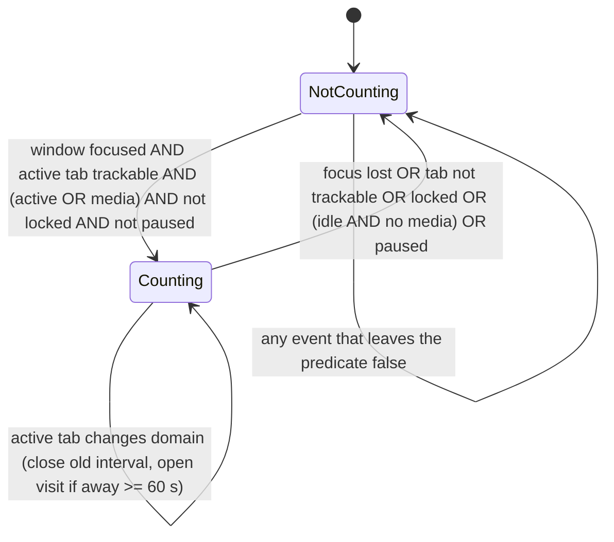
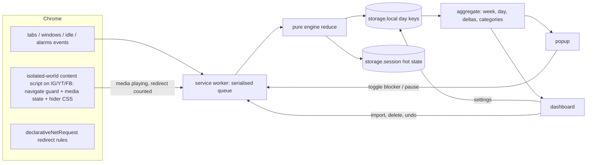
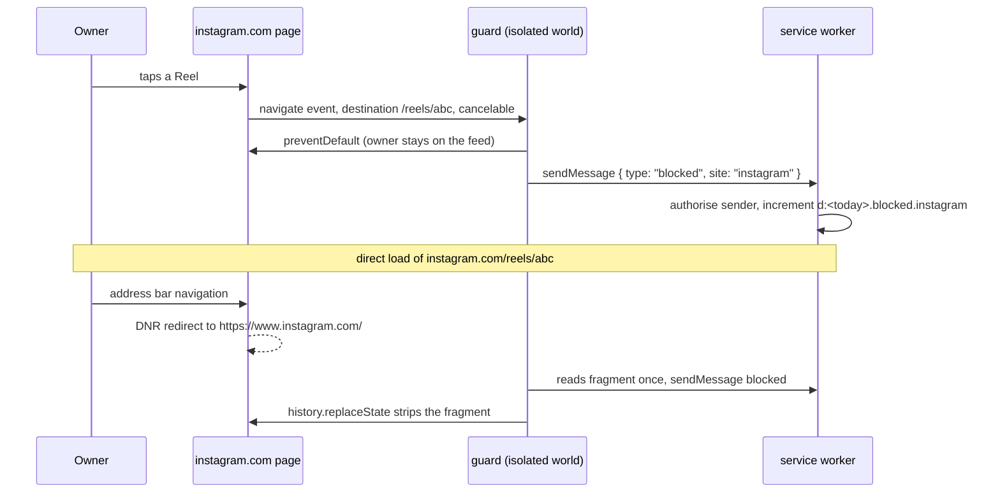

# Dwell Screen Time Extension - Plan

## Goal Capsule

- **Objective:** ship a personal, open-source Chrome extension (Manifest V3) that records active time per website like iPhone Screen Time, shows it in a popup and a full dashboard, and blocks Instagram Reels, YouTube Shorts and Facebook Reels with per-site toggles, with every byte staying in the browser.
- **Authority:** this plan, then the design system in `design/DESIGN.md`, then the shared rules of the parent folder. Product decisions the user has not confirmed are listed under Assumptions and carry a default; implement the default.
- **Execution profile:** test-first for the tracking engine, the URL classifier and the aggregation math; smoke-first for manifest, build and UI shell; real-browser proof for tracking and blocking before any unit is called done.
- **Stop conditions:** a permission beyond the declared list becomes necessary; a privacy claim in the README cannot be backed by a test; Instagram, YouTube or Facebook DOM changes make a hider impossible without JavaScript that reads page content.
- **Tail ownership:** the executor runs the gates in Verification Contract, then `!/security-check` and `!/code-review` before the first push to `main`, and writes `docs/changelog.md`, `docs/project_status.md`, `docs/architecture.md`.
- **Attribution:** no AI or vendor attribution in commits, PR bodies or file content. The repo is the user's portfolio.

---

## Product Contract

### Summary

Dwell is a Chrome extension for one person. It attributes each second of browsing to the website in the focused window's active tab, only while the user is present, and keeps 90 days of per-day, per-hour, per-domain totals locally. A toolbar popup shows today at a glance, the way the iPhone Screen Time widget does. A full dashboard page shows one week at a time with a 7-day chart, an hourly day view, a most-used list with deltas against the previous week, categories, and the number of Reels/Shorts redirects. The same extension turns Reels and Shorts off per site with one tap from the popup. It has no network access by design, and the test suite proves it.

### Problem Frame

Browser time trackers either count wall-clock time while a tab is open (so a music tab or a forgotten window inflates everything) or require an account and send browsing data to a server. Reels and Shorts blockers are separate extensions, often closed source, and break silently when the sites change. The user wants one small, auditable tool that counts the way a person would count ("was I actually on it?"), shows a week the way Screen Time does, and makes the short-video feeds one tap harder to fall into, without trusting anyone with the data.

### Requirements

**Tracking**

- R1. A second is attributed to a domain only when a Chrome window is focused, the tab is that window's active tab, and the user is not idle.
- R2. Media override (a setting, default on): when the active tab in the focused window is playing video or audio, the idle state does not stop counting; the locked state always stops counting. Audio in a background tab or an unfocused window never counts.
- R3. Idle threshold is a setting (30, 60, 120 or 300 s), default 60 s.
- R4. After any gap without events longer than 1.5 heartbeats (system sleep, service worker termination, browser shutdown), at most one heartbeat (60 s) is attributed to the state before the gap, and the state is rebuilt from the live browser.
- R5. A visit is counted when a domain becomes the counted domain after at least 60 s of not being counted.
- R6. Tracking can be paused from the popup; while paused nothing is recorded and every surface shows the paused state.
- R7. An ignore list of domains is never recorded.
- R8. Non-web URLs (chrome://, chrome-extension://, file://, about:, the new tab page) and incognito tabs are never recorded.

**Storage and privacy**

- R9. Only the registrable domain (eTLD+1) is stored, with a user-editable override list that splits named subdomains into their own sites. Full URLs and page titles are never stored.
- R10. Data is kept for 90 rolling days and pruned daily.
- R11. The extension makes no network requests; the manifest forbids them, an automated test shows a `fetch` from the service worker and the dashboard fails, and a build check keeps network APIs and dynamic code out of the bundle. The README says "auditable", not "provable".
- R12. The user can export all data as JSON, import a previous export, and delete everything with one action.
- R13. Permissions are limited to `tabs`, `idle`, `storage`, `alarms`, `declarativeNetRequest`; host permissions and content-script matches are a literal list of `https://` patterns for the www, m and bare hosts of instagram.com, youtube.com and facebook.com, top frame only; the manifest declares `incognito: not_allowed` and no `externally_connectable`.

**Blocking**

- R14. Instagram Reels, YouTube Shorts and Facebook Reels can each be turned off and on; defaults are on.
- R15. A YouTube Shorts URL is rewritten to the ordinary watch page for the same video instead of being sent to the home page.
- R16. When the current tab is one of the three sites, the popup shows that site's toggle and changes it with one click and no confirmation.
- R17. Each redirect is counted per site per day and shown in the dashboard as information.
- R18. Instagram Explore can optionally be blocked; default off.

**Popup**

- R19. The popup shows today's total, a comparison with the 7-day daily average, a 7-day bar chart with today highlighted, the top 3 sites of the day, the current site's time and visits, the current site's blocker toggle when it has one, a pause switch and a link to the dashboard.

**Dashboard**

- R20. The dashboard shows one week at a time with previous and next navigation over every Monday-start week the retained 90 days touch (13 or 14 weeks).
- R21. The week view shows the week total, the daily average, the change against the previous week in plain words, and a 7-day bar chart; selecting a day opens a day view with 24 hourly bars.
- R22. A most-used list for the week shows each site's time, share, visits, change against the previous week and category.
- R23. A category breakdown (Social, Video, Work, Shopping, News, Other) uses a built-in domain map the user can edit.
- R24. Settings cover idle threshold, media override, blockers, grouping overrides, ignore list, categories, export, import, delete all and the event log toggle.
- R25. A privacy panel states what is stored, where, why each permission exists, that Dwell's own pages and worker are configured to refuse network requests, that its scripts run only on the three sites and send nothing off the device, and that redirects stay within those sites.
- R26. Light and dark modes follow the system and can be forced.
- R27. No streaks, no guilt copy, no red over-limit states, no notifications; deltas are information.
- R28. English first, with all strings in `chrome.i18n` message files and `default_locale: en`; the UI follows the browser locale, and French ships later as `_locales/fr` without code changes.

**Quality**

- R29. The tracking engine is pure and is exercised by property-based simulations with the invariants listed in U2.
- R30. Tracking and blocking are verified in a real Chromium with the extension loaded, not only in unit tests.
- R31. The repository is publishable on GitHub: README with the privacy proof, screenshots, install steps, licence, and no AI attribution anywhere.

### Actors

- A1. **Owner** — the single user; installs unpacked, reads the dashboard, flips blockers.
- A2. **GitHub reader** — a sceptic who audits the manifest, the CSP, the tests and the bundle before trusting the privacy claim.

### Key Flows

- F1. **Counting a session.** Owner focuses a Chrome window and clicks a YouTube tab; the engine starts attributing to youtube.com. Owner stops moving the mouse while a video plays: the tab is playing media, so counting continues. Owner alt-tabs to another app: the window loses focus and counting stops within one event. Owner returns after 10 minutes: a new visit starts.
- F2. **Blocking a Reel.** Owner is on instagram.com and taps a Reel in the feed; the guard sees the navigation to `/reels/…` before it commits, cancels it, and reports the block to the worker; the owner stays where they were and the day's count increments.
- F3. **Turning a blocker off.** Owner opens the popup on youtube.com, clicks "Shorts off" to turn it off; the next Shorts URL loads normally. No confirmation dialog.
- F4. **Reading the week.** Owner opens the dashboard: the current week, the total, "14% less than last week", the 7 bars, the most-used list. Owner clicks Tuesday: the 24 hourly bars for Tuesday and Tuesday's top sites.
- F5. **Audit by a GitHub reader.** Reader opens `manifest.json`, sees the permission list and the CSP, runs the test suite, and sees the test that asserts `fetch` is refused and the test that greps the built bundle for network APIs.

### Acceptance Examples

- AE1. Music plays in a Spotify tab in window A while the owner types in a Google Docs tab in window B for 30 minutes: docs.google.com gains 30 minutes, spotify.com gains 0.
- AE2. A YouTube video plays in the focused active tab for 25 minutes with no input: youtube.com gains 25 minutes with media override on, about 1 minute with it off.
- AE3. The laptop sleeps for 8 hours while a tab is active and focused: the previous domain gains at most 60 s (one heartbeat).
- AE4. A session runs from 23:58 to 00:03: 2 minutes land in the first day's hour 23 and 3 minutes in the next day's hour 0.
- AE5. The owner opens instagram.com/reels/abc123 directly: the request is redirected before the page paints to the home page carrying a fragment marker; the guard script counts it once, strips it, and the dashboard's block count for Instagram increments by one. Tapping a Reel inside the feed is cancelled in the page and counted by the guard with no marker at all.
- AE6. The owner clicks a Shorts link to youtube.com/shorts/XYZ: the tab lands on youtube.com/watch?v=XYZ.
- AE7. The owner locks the screen while a video is playing: counting stops at the lock event even though the tab is audible.
- AE8. The service worker is terminated mid-session and wakes on the next tab switch: totals equal what an uninterrupted run would have produced within one heartbeat.

### Success Criteria

- The owner recognises their own day in the popup without explanation.
- A week of real use shows no site inflated by background media.
- The GitHub reader can verify the privacy claim from the repo in under five minutes.

### Scope Boundaries

- **Not in this plan:** Firefox or Safari builds; sync between devices; time limits or lockouts; notifications or weekly reports; per-URL or per-video tracking; categories beyond a domain map; encryption at rest (threat model: anyone with the OS account already has Chrome history).
- **Deferred to follow-up work:** blocker schedules (for example, off during work hours); French translation files and a manual language override (needs a build-time message loader, since `chrome.i18n` follows the browser locale and the CSP forbids fetching message files); unlisted Chrome Web Store listing; an optional screenshot-free "share my week" image export; hiding Reels embedded inside the Instagram home feed beyond the nav and explore entry points.

### Dependencies

- Chrome 120 or later (alarm minimum 30 s, `chrome.storage.session` 10 MB).
- No external services. Fonts are bundled, never loaded from Google Fonts at runtime.

---

## Planning Contract

### Key Technical Decisions

- **KTD1. The engine is a pure reducer keyed on timestamps, never on tick counts.** `reduce(state, event) -> { state, attributions[] }` where every event carries `at` (epoch ms) and attributions are computed for the interval since the previous event. Alarm drift, delayed events and service worker restarts cannot change totals because nothing counts alarm firings. This is what makes property-based simulation possible.
- **KTD2. Presence = focused window AND active tab AND (not idle OR media playing) AND not locked AND not paused.** Media playing comes from a content script on the three host-permitted sites (it reports whether a `video` element is playing, muted or not) and from `tab.audible` everywhere else, with 30 s hysteresis so gaps between songs do not flip the state. `locked` always wins. Rationale: `tab.audible` reports recent sound output, so it can be true while the tab is muted and is false for silent video; the content script reports the real playing state of video elements on the sites that matter most without widening host permissions.
- **KTD3. Storage shape: one key per local day.** `d:2026-10-14 -> { sites: { "youtube.com": { h: { "21": 1340, "22": 610 }, v: 3 } }, blocked: { instagram: 4 } }` in `chrome.storage.local`. Hours are sparse. Hot state (`currentDomain`, `lastAt`, `focused`, `idle`, `media`, `paused`) lives in `chrome.storage.session`; `paused` is a boolean because R6 defines an open-ended pause ended from the popup. Hot state also keeps `lastCountedAt` per site for the current day so R5 visits can be decided. Settings live under `settings`. A daily alarm deletes day keys older than 90 days. Export is the day keys plus settings, never the log; import validates against the schema (U3) and merges by day.
- **KTD4. Single-page navigation blocking happens inside the page, before it commits, from the isolated world.** A guard content script at `document_start` on the three sites listens to the Navigation API `navigate` event and calls `preventDefault` when the destination matches a blocked pattern and the event is cancelable; `popstate`, YouTube's `yt-navigate-finish` and a 250 ms `location.href` poll are fallbacks that call `location.replace(target)` if a blocked path is ever current. The isolated world keeps `chrome.runtime` and `chrome.storage` available and keeps the guard invisible to page scripts. Wrapping `history.pushState` in the MAIN world is the fallback decision if the U5 prototype shows the isolated world cannot see a site's route changes. Path matching is unanchored (`/username/reels/` counts). `declarativeNetRequest` redirect rules (`regexSubstitution`, `main_frame` only so embedded Reels in other pages are left alone, Shorts id restricted to `[A-Za-z0-9_-]{11}`) cover hard navigations with no flash; `chrome.tabs.onUpdated` is not used. A loop guard stops after 2 redirects per tab in 5 s, and no redirect target matches a blocked pattern.
- **KTD4b. Redirects are counted by the guard script, never by the DNR layer, and in-page blocks carry no marker.** `onRuleMatchedDebug` works only unpacked and `getMatchedRules` is rate-limited and needs another permission. An in-page block is reported by the guard with `chrome.runtime.sendMessage({ type: "blocked", site })` and nothing is added to any URL. A DNR hard-load redirect lands on a target carrying a fragment marker (`#dwell=<site>`), which browsers never send to servers or in Referer; the guard counts it at most once per navigation, treats it as a hint, and strips it with `history.replaceState`. No redirect target ever carries a query parameter named `dwell`.
- **KTD4c. The worker authorises every message by sender.** `runtime.onMessage` rejects any sender whose `id` is not the extension's. Content-script senders (a `sender.tab` whose URL host is one of the three sites) may send only `blocked { site }` and `media { playing: boolean }`. Settings, pause, blocker toggles, export, import and delete are accepted only from extension pages (`sender.url` under the extension origin). Message payloads are validated for shape before use, and no content-script message type carries a URL or title.
- **KTD5. Privacy is enforced in the manifest and checked by three tests; the claim is "auditable", not "provable".** Manifest CSP `extension_pages`: `default-src 'none'; script-src 'self'; style-src 'self'; img-src 'self' data:; font-src 'self'` (the Chrome docs state this CSP applies to worker contexts). A Playwright test calls `fetch` from the service worker and from the dashboard page and asserts both are refused. A build test greps `dist/` for `fetch(`, `XMLHttpRequest`, `WebSocket`, `sendBeacon`, `importScripts(`, `eval(`, `new Function`, `new Image`, `EventSource`, `WebTransport`, `RTCPeerConnection`, `import(`, `window.open` and fails on any hit. ESLint bans computed member access on `globalThis`, `self` and `window` (closes the `self['fe'+'tch']` evasion), `eval`, and `createElement` of script, link or iframe. A unit test asserts every `tabs.update`, `tabs.create`, `windows.create`, `location.replace` and DNR redirect target comes from one constant allowlist of the three sites. Vite's modulepreload polyfill (which contains `fetch(`) is disabled in `vite.config.ts`. Content scripts (guard, media, CSS) run under the page's CSP, so the grep and lint cover them explicitly, and `runtime.setUninstallURL` is never called. A Playwright run records every network request during a full tracking and blocking session and asserts none leaves the fixture host and the three sites.
- **KTD6. All events in the service worker pass through one serialised queue.** Chrome can deliver `onActivated`, `onFocusChanged` and `onStateChanged` within the same millisecond; concurrent read-modify-write of session state loses attributions. A promise chain processes one event at a time; the simulation suite's restart-equivalence invariant assumes this.
- **KTD7. Startup and every wake after a gap seed state from the live browser.** On `runtime.onStartup`, `runtime.onInstalled`, whenever session state is missing, and whenever the gap since `lastAt` exceeds 1.5 heartbeats, the worker queries the last-focused window and its active tab, `idle.queryState`, recreates the heartbeat and prune alarms, reconciles the enabled DNR rulesets with the stored blocker settings, and starts attributing from "now". The first event after a gap is capped by R4, and the order in which the missed alarm and the idle event arrive on wake cannot change the result because the cap applies to the interval, not the event.
- **KTD8. Domain grouping uses a small bundled public-suffix subset.** About 60 two-level suffixes (co.uk, com.au, qc.ca, …) plus the user override list, instead of the full Public Suffix List (250 KB). Wrong groupings for exotic TLDs are correctable by an override. Trade-off accepted for bundle size and auditability.
- **KTD9. Time buckets are local time at attribution.** An interval is split at every local hour boundary it crosses, so midnight and DST transitions produce correct day and hour keys; a clock that moves backwards yields a zero-length interval, never a negative one.
- **KTD10. A 24-hour event ring buffer (local only) makes real days replayable.** The worker keeps the last 24 hours of events in `chrome.storage.local` under `log:`, each entry holding only the timestamp, the event kind and the grouped site id, never a path, query or title (R9). A separate "export event log" action in settings produces a fixture the simulation suite can replay, turning a real mis-count into a regression test; the ordinary data export never includes it. Committed fixtures come from the simulator or from a scrub script that maps real site ids to synthetic ones, and a test fails on any fixture or log entry containing `://` or a path. Off by default in release, toggle in settings.
- **KTD11. Stack: TypeScript, Vite with the CRXJS plugin, Preact as the only runtime dependency, hand-drawn inline SVG charts, Vitest, fast-check, Playwright, ESLint with the KTD5 privacy rules.** Preact keeps the dashboard maintainable at 4 KB; no chart library keeps the bundle auditable and dependency-free.
- **KTD12. Distribution: unpacked now, unlisted Chrome Web Store later.** A release workflow builds from a committed lockfile with `npm ci --ignore-scripts`, on GitHub Actions pinned to commit SHAs and with no secrets exposed, and publishes a per-file hash list so an installed store build can be compared file by file (the store repackages the zip, so a zip hash would not match).

### High-Level Technical Design

Presence state machine (the counting rule). Attribution for the interval between two events uses the state before the second event.



Component topology.



Blocking sequence for a Reel tapped inside the Instagram feed, and for a direct load.



### Output Structure

```text
dwell/
  manifest.json
  package.json
  vite.config.ts
  src/
    background/   index.ts  queue.ts  startup.ts  events.ts  alarms.ts
    tracker/      engine.ts  types.ts  buckets.ts  grouping.ts  suffixes.ts
    store/        schema.ts  storage.ts  prune.ts  export.ts
    blocker/      patterns.ts  targets.ts  rulesets/ (instagram-reels, youtube-shorts, facebook-reels, instagram-explore .json)
    content/      guard.ts  media.ts  instagram.css  youtube.css  facebook.css
    stats/        aggregate.ts  weeks.ts  format.ts  categories.ts
    popup/        index.html  main.tsx  Popup.tsx  (components)
    dashboard/    index.html  main.tsx  (Week, Day, MostUsed, Categories, Blocked, Settings, Privacy)
    shared/       messages.ts  settings.ts  i18n.ts  theme.css  fonts/
  _locales/en/messages.json
  tests/
    engine.sim.test.ts  engine.scenarios.test.ts  buckets.test.ts  grouping.test.ts
    storage.test.ts  patterns.test.ts  aggregate.test.ts  privacy.bundle.test.ts
    fixtures/ (replayed event logs)
    e2e/  tracking.spec.ts  blocker.spec.ts  privacy.spec.ts  ui.spec.ts
  scripts/  simulate.ts (seed 90 days of plausible data)  zip.ts
  design/   DESIGN.md  prototype.html  screens/
  docs/     architecture.md  changelog.md  project_status.md  plans/
  .github/workflows/  ci.yml  release.yml
  eslint.config.js  LICENSE  README.md
```

### Assumptions

Defaults the executor implements unless the user overrides them:

- Name: Dwell. Folder `code-projects/dwell`, repo `dwell`.
- Idle threshold 60 s; media override on.
- Shorts rewrite to the watch page; Instagram and Facebook Reels redirect to the site home; Explore blocking off.
- Visits counted; week starts Monday.
- Built-in category map of about 40 domains; everything else Other until edited.
- English UI; FR deferred.
- Unpacked install; Web Store deferred.
- The 24-hour event log (KTD10) ships, off by default, as the way to turn a real mis-count into a test; dropping it entirely is the user's call.
- The design pass in `design/` is the visual source; the dashboard and popup implement it, they do not reinterpret it.

### Open Questions

- **Deferred:** whether hiding Reels inside the Instagram home feed is worth a selector that will break monthly. Ship nav and explore hiding first, decide from real use.
- **Deferred:** whether to count time in Chrome's own pages (new tab, settings) as "Chrome" rather than ignore it. Ignore for now.

### Risks and Dependencies

- **Site markup churn** breaks the CSS hiders silently. Mitigation: the URL guard and DNR rules carry the function; hiders are cosmetic; selectors live in one file per site with a date comment.
- **`tab.audible` semantics** (true while muted, false for silent video) under-count muted video on sites without the content script. Mitigation: documented in the privacy panel and settings; the three big sites use the content script.
- **Chrome idle is system-wide**, so reading a long page without input for longer than the threshold stops counting. Mitigation: threshold setting up to 300 s.
- **Two visible Chrome windows**: only the focused one counts. Documented; same model as a phone. Some Linux window managers send a transient `WINDOW_ID_NONE` between Chrome windows, and DevTools windows read as none; attribution by timestamp makes these cost milliseconds, not sessions.
- **Media override overcounts a walk-away** with a video left playing in a focused window until the screen locks. Accepted as the same model as a phone with the screen on; documented in settings, and the override can be turned off.
- **`chrome.storage.session` is cleared on browser restart**; the last heartbeat before shutdown is lost (at most 60 s). Accepted.
- **CSP coverage is documented for worker contexts, but content scripts run under the page's CSP.** Mitigation: KTD5 tests the behaviour, lints the sources and records real network traffic instead of trusting a directive.
- **A heartbeat delayed past 1.5 heartbeats** (battery saver, heavy load) triggers the R4 cap during real use and under-counts by the overrun. Accepted; rare and bounded.
- **Incognito with `not_allowed`**: whether focusing an incognito window reports `WINDOW_ID_NONE` to the extension is not documented. Covered by the U4 manual checklist.

### Sources and Research

- Chrome docs verified 2026-10-14: `chrome.idle` default 60 s, minimum 15 s, states active/idle/locked; `chrome.alarms` minimum 30 s, recreate on start, a missed repeating alarm fires once on wake; `chrome.storage.local` 10 MB, `session` 10 MB cleared on restart; DNR redirect needs host permissions, `onRuleMatchedDebug` is unpacked-only and `getMatchedRules` is rate-limited; `tab.audible` means "produced sound in the last seconds"; the `extension_pages` CSP applies to worker contexts; `windows.onFocusChanged` may report none transiently on some Linux window managers; Web Store fee $5 one-time, unlisted visibility exists.
- Confirmed by a secondary source only: `tabs.onUpdated` fires on `pushState` but after commit (Eric Lawrence, 2024). Not used for blocking; the guard acts before commit.
- Prior art read on 2026-10-14: LeechBlock NG discards time jumps above a threshold (same idea as R4); PsychoSanchez's web-activity-plugin uses the same locked/idle/audible state machine and found the focus event unreliable enough to poll; ActivityWatch issue 163 is a user complaint that a 20-minute video counted as 13 minutes because the audible tab was treated as away, which is why the media override defaults on; Web Activity Time Tracker's Chrome listing was sold in 2026 and began showing ads, which is why trust and licence terms are in U9.
- Prior-art and selector scan: see Appendix.

---

## Implementation Units

### U1. Scaffold, manifest and the privacy floor

**Goal:** a building, loadable extension with the final permission list, CSP, bundled font, test runners and CI, and the bundle-grep privacy test green from day one.

**Requirements:** R11, R13, R31.

**Dependencies:** none.

**Files:** `manifest.json`, `package.json`, `vite.config.ts`, `tsconfig.json`, `eslint.config.js`, `src/background/index.ts` (empty worker), `src/popup/index.html`, `src/dashboard/index.html`, `src/shared/fonts/`, `tests/privacy.bundle.test.ts`, `tests/e2e/privacy.spec.ts`, `.github/workflows/ci.yml`, `README.md` (skeleton), `LICENSE` (MIT).

**Approach:** Vite + CRXJS build with `build.modulePreload.polyfill` off; `manifest.json` carries exactly the R13 permissions, the literal match-pattern list, `incognito: not_allowed`, `default_locale: en`, the four DNR ruleset declarations and the KTD5 CSP; the font files ship in the bundle; CI runs `npm ci --ignore-scripts`, typecheck, lint, unit tests, build, the bundle grep and zips the build as an artifact, on actions pinned to commit SHAs. `npm audit --audit-level=high` runs on install per `rules/security.md`.

**Execution note:** packaging and config; prove by loading unpacked in Chrome and by the grep test, not by unit coverage.

**Test scenarios:**
- Built bundle contains none of `fetch(`, `XMLHttpRequest`, `WebSocket`, `sendBeacon`, `importScripts(`, `eval(`, `new Function` outside the test file itself.
- ESLint fails on `self['x']`, `globalThis[name]` and `window[expr]` computed access and on `eval`.
- Manifest permission list equals the R13 list exactly; `host_permissions` and every content-script `matches` entry equal the literal expected pattern list; `all_frames` is false; no `<all_urls>` anywhere; `incognito` is `not_allowed`; no `externally_connectable`.
- Built `dist/manifest.json` `web_accessible_resources` (added by the CRXJS loader) match only the three site patterns.
- Manifest CSP string contains `default-src 'none'`.
- E2E (`tests/e2e/privacy.spec.ts`): `fetch('https://example.com')` from the service worker rejects; the same from the dashboard page rejects; a `` with a remote `src` injected into the dashboard never loads.

**Verification:** extension loads unpacked without warnings; CI green; zip produced.

### U2. Pure tracking engine with simulation suite

**Goal:** the counting rule as a pure reducer, proven by property-based simulations and scenario tests before it touches Chrome.

**Requirements:** R1, R2, R3, R4, R5, R6, R7, R8, R29.

**Dependencies:** U1.

**Files:** `src/tracker/engine.ts`, `src/tracker/types.ts`, `src/tracker/buckets.ts`, `src/tracker/grouping.ts`, `src/tracker/suffixes.ts`, `tests/engine.sim.test.ts`, `tests/engine.scenarios.test.ts`, `tests/buckets.test.ts`, `tests/grouping.test.ts`, `tests/fixtures/`.

**Approach:** events are a discriminated union (`focus`, `activate`, `url`, `idle`, `media`, `pause`, `tick`, `gap`) each with `at`; media hysteresis means a site is treated as playing until 30 s after the last `playing` signal, so gaps shorter than 30 s are bridged and a `paused` signal ends it within 30 s; the reducer closes the open interval against the previous state, splits it at local hour boundaries (KTD9), applies the gap cap (R4), decides visits (R5), and returns attributions plus the next state. Grouping maps a URL to a site id or `null` for non-trackable URLs (R8), using the suffix subset and overrides (KTD8). A fast-check arbitrary generates random event sequences with monotonic timestamps; scenario tests encode F1 and AE1 to AE4 and AE7 to AE8 as named stories.

**Execution note:** test-first; write the invariants before the reducer and watch them fail.

**Test scenarios:**
- Invariant: total attributed seconds never exceed the wall-clock span of the sequence.
- Invariant: zero attribution for any interval where the focused window id is none.
- Invariant: zero attribution while idle unless media is playing; zero while locked regardless of media.
- Invariant: for any interval, exactly one site or none receives it (exclusivity).
- Invariant: every attribution lands in the day and hour of its own interval; an interval crossing a boundary is split with no loss (AE4).
- Invariant: a gap longer than 1.5 heartbeats attributes at most one heartbeat (60 s) to the pre-gap state (R4, AE3).
- Invariant: replaying the same sequence twice yields identical buckets (determinism).
- Invariant: serialising state after any prefix and resuming yields the same buckets as the uninterrupted run (AE8).
- Invariant: visits increase by one exactly when a site becomes counted after at least 60 s not counted.
- Oracle: for every generated sequence, the engine's buckets equal a naive reference model that walks the sequence one second at a time and asks "focused, active, present?" at each second. This is the lower bound; the upper-bound invariants alone are satisfied by an engine that attributes nothing.
- Robustness: sequences with duplicated events, events delivered up to 200 ms out of order, and dropped heartbeats produce buckets within one heartbeat of the oracle and never throw.
- Scenario AE1, AE2 (both override settings), AE7, F1.
- Grouping: `www.youtube.com` and `m.youtube.com` map to `youtube.com`; `music.youtube.com` maps to itself when overridden; `bbc.co.uk` maps to `bbc.co.uk`; grouping is an http(s) allowlist, so `chrome://extensions`, the new tab page, `blob:`, `data:`, `file:`, `view-source:`, `devtools:` and `chrome-untrusted:` all map to null; an ignore-listed domain maps to null.
- Buckets: a clock moving backwards yields a zero-length interval; a DST day with 23 or 25 local hours never throws and preserves totals; the same tests pass under `TZ=UTC`, `TZ=America/Toronto`, `TZ=Asia/Kolkata` and `TZ=Australia/Lord_Howe`.

**Verification:** all invariants pass over at least 2,000 generated sequences; scenario tests green; 90%+ coverage on `src/tracker`.

### U3. Storage layer

**Goal:** persist attributions, hot state and settings in the KTD3 shape, with prune, export, import and delete.

**Requirements:** R9, R10, R12.

**Dependencies:** U2.

**Files:** `src/store/schema.ts`, `src/store/storage.ts`, `src/store/prune.ts`, `src/store/export.ts`, `src/shared/settings.ts`, `tests/storage.test.ts`.

**Approach:** a thin adapter over `chrome.storage.local` and `chrome.storage.session` with an in-memory fake for tests; day keys are read-modify-written one at a time; prune lists keys, keeps the newest 90 local dates; export emits `{ version, exportedAt, days, settings }` and the export UI says the file is a readable browsing summary; import is hardened: file size capped (2 MB), day and domain counts capped, only `d:YYYY-MM-DD` keys inside the 90-day window, domain keys matched against a hostname regex with `__proto__`, `constructor` and `prototype` rejected, hour values integers in 0..3600, visits non-negative integers, settings run through the same validator as the settings UI, merged objects built from `Object.create(null)`, the full merge computed in memory and committed in one `storage.local.set` so a failure leaves the store unchanged; the merge takes the larger value per hour so a re-import never double counts. Import, delete-all and undo are executed by the worker through the KTD6 queue; undo data lives only in worker memory for 10 s and never in storage.

**Test scenarios:**
- Writing attributions for two sites in the same hour accumulates both under the same day key.
- Prune deletes exactly the keys older than 90 days measured in local dates and never touches settings or the log.
- Export then import into an empty store reproduces identical day keys.
- Import of an export over existing data never lowers any value and never duplicates visits.
- Import of malformed JSON is rejected with a user-readable message and changes nothing.
- Import with a `__proto__` domain key, a negative hour, an hour above 3600, a key outside the 90-day window or a file above 2 MB is rejected whole, with the specific reason, and changes nothing.
- Import that fails validation on the last day of 60 leaves all 60 untouched (single commit).
- Closing the dashboard during the 10 s undo window leaves storage empty; undo after the window reports that it is no longer available.
- Delete all removes day keys, session state and the log, and keeps nothing but defaults.
- No entry under any `log:` key contains a `/`, a `?` or a page title, for a recorded sequence that includes full URLs.

**Verification:** tests green; a 90-day simulated store stays under 1 MB.

### U4. Service worker wiring, startup and heartbeat

**Goal:** connect Chrome events to the engine through a serialised queue, survive worker restarts, and prove tracking in a real browser.

**Requirements:** R1, R2, R4, R6, R30.

**Dependencies:** U2, U3.

**Files:** `src/background/index.ts`, `src/background/queue.ts`, `src/background/startup.ts`, `src/background/events.ts`, `src/background/alarms.ts`, `src/content/media.ts`, `src/shared/messages.ts`, `tests/e2e/tracking.spec.ts`.

**Approach:** listeners for `tabs.onActivated`, `tabs.onUpdated` (url and audible), `tabs.onRemoved`, `windows.onFocusChanged`, `windows.onRemoved`, `idle.onStateChanged`, `alarms.onAlarm` and content messages push events onto the queue (KTD6); each event rehydrates state from session storage if the worker was restarted (KTD7), reduces, writes attributions and state, and returns. The heartbeat alarm fires every 60 s. The media content script posts `playing` and `paused` for the three sites. Events from tabs or windows with `incognito: true` are mapped to a non-trackable URL before reduction, so the engine never sees an incognito domain (R8). The optional ring-buffer recorder (KTD10) appends events after grouping, so it holds site ids, never paths.

**Execution note:** smoke in a real Chromium first; the Playwright test drives what it can drive (tab switches, pause, the media message, worker restart through a CDP `ServiceWorker.stopAllWorkers` call) against a local fixture site and asserts storage within a 3 s tolerance. Window blur, idle, lock, sleep and the incognito focus behaviour are OS-driven and go on a named manual checklist run in headed Chrome on the owner's machine and recorded in `docs/project_status.md`; the engine scenario tests are their automated proof.

**Test scenarios:**
- Open fixture site A for 10 s, switch to fixture site B for 5 s: A has 9 to 11 s, B has 4 to 6 s.
- Stop the worker through CDP mid-session, then switch tabs: totals continue within one heartbeat (AE8).
- Pause from the popup, browse 10 s, resume: nothing recorded during the pause.
- Media script: a playing muted `video` on the YouTube fixture sends `media { playing: true }` and nothing else; a unit test feeds that event with idle and asserts counting continues when override is on.
- Worker rejects a `settings` message whose sender is a tab, and rejects a `blocked` message whose sender tab is not on one of the three sites.
- Manual checklist (recorded, not automated): blur the window 10 s, no site gains more than 1 s; lock the screen with a video playing, counting stops (AE7); close the lid 10 min, at most 60 s attributed (AE3); focus an incognito window, nothing recorded.

**Verification:** e2e spec green headed and headless; the recorder export replays through U2 with identical totals.

### U5. Blocker: URL classifier, in-page guard, DNR rules, hiders, toggles

**Goal:** Reels and Shorts off by default on the three sites, instant and loop-free, with per-site toggles and counted redirects.

**Requirements:** R14, R15, R16, R17, R18.

**Dependencies:** U1, U3.

**Files:** `src/blocker/patterns.ts`, `src/blocker/targets.ts`, `src/blocker/rules.json`, `src/content/guard.ts`, `src/content/instagram.css`, `src/content/youtube.css`, `src/content/facebook.css`, `tests/patterns.test.ts`, `tests/e2e/blocker.spec.ts`.

**Approach:** `patterns.ts` is a pure classifier `classify(url, settings) -> { site, target } | null` covering `/reels/`, `/reel/` anywhere in the path and `/explore/` (optional) on instagram.com, `/shorts/ID` on youtube.com and m.youtube.com (target `/watch?v=ID`), `/reel/` and `/reels/` on facebook.com and m.facebook.com; DNR targets carry the `#dwell=<site>` fragment, in-page targets carry nothing. The guard (KTD4) runs at `document_start` in the isolated world, cancels blocked `navigate` events, falls back to `popstate`, `yt-navigate-finish` and a 250 ms poll with `location.replace` and a loop guard, reports blocks with `sendMessage`, and on landing with a fragment counts once and strips it (KTD4b). The first task of this unit is a prototype on the live sites proving the isolated-world `navigate` event sees each site's route changes; if one site defeats it, that site gets the MAIN-world `pushState` wrap plus a CustomEvent relay to the isolated world. Four static DNR rulesets (`instagram-reels`, `youtube-shorts`, `facebook-reels`, `instagram-explore`) mirror the classifier for hard loads with `regexSubstitution` and are enabled or disabled per site with `updateEnabledRulesets`; the worker reconciles them with settings at startup (KTD7) and the hider CSS is scoped by a `data-dwell-<site>` attribute the guard sets from settings and updates on `storage.onChanged`. Hider CSS per site hides the Reels and Shorts nav entries and shelves; selectors come from the Appendix, live in one dated file per site, and are cosmetic.

**Test scenarios:**
- Classifier table: each URL variant (www, m, trailing slash, query string, uppercase ID, `/shorts/` with no ID) maps to the expected target or null.
- A target URL never classifies as blocked (loop guard), for every pattern; `/someuser/reels/` on Instagram classifies as blocked.
- The guard stops redirecting after 2 redirects in 5 s on the same tab and logs nothing else.
- A site with its toggle off classifies to null for its own patterns and leaves the others intact.
- Landing on a target URL with the fragment increments the day's count once, and the fragment is gone from the address bar within one frame; reloading the landing page does not count again.
- No classifier or DNR target contains a query parameter named `dwell`; every DNR rule is limited to `main_frame`; a Shorts path with a 12-character id or a `?` inside the id does not match.
- E2E: toggling Instagram off in storage removes the hider attribute and stops the guard without a reload, and a hard load of `/reels/x` passes through.
- E2E: direct navigation to a Shorts URL lands on the watch page for the same ID (AE6).
- E2E: `history.pushState` to `/reels/x` on a local fixture page served under the Instagram host pattern is replaced within 500 ms and the day's block count increments (AE5).
- E2E: toggling Instagram off from the popup makes the next `/reels/x` load without redirect.

**Verification:** classifier tests green; e2e green; manual check on the live sites once each, recorded in `docs/project_status.md`.

### U6. Aggregation, formatting, categories and the data simulator

**Goal:** every number the UI shows, computed by pure functions, plus a seeded generator of 90 plausible days for development and screenshots.

**Requirements:** R20, R21, R22, R23.

**Dependencies:** U3.

**Files:** `src/stats/aggregate.ts`, `src/stats/weeks.ts`, `src/stats/format.ts`, `src/stats/categories.ts`, `scripts/simulate.ts`, `tests/aggregate.test.ts`.

**Approach:** `weeks.ts` derives the navigable Monday-start weeks from the stored date range (13 or 14); `aggregate.ts` produces week totals, daily averages over days with data, per-site rows with share, visits and delta against the previous week, hourly series for a day, and category sums; `format.ts` renders durations (`1h 12m`, `42m`, `<1m`) and plain-word deltas; `categories.ts` holds the default map. `simulate.ts` seeds a store from a seed value with weekday and weekend shapes and evening peaks.

**Execution note:** test-first for delta and week-boundary math.

**Test scenarios:**
- A week with data on 5 days reports the daily average over 5 days, not 7.
- Delta is "no change" when the previous week is empty, never a division by zero or an infinite percentage.
- The week containing today is the last navigable week; the first is the week containing the oldest retained day, so a Monday today yields 14 weeks and a Sunday yields 13.
- The oldest navigable week, whose previous week is outside retention, reports "no change" rather than a delta against partial data.
- Hourly series for a day returns 24 entries with zeros where no data exists.
- Category sums equal the week total.
- Formatting: 59 s renders `<1m`; 3,600 s renders `1h`; 4,320 s renders `1h 12m`.
- Simulator with the same seed produces identical data twice.

**Verification:** tests green; the simulator seeds a dev profile used by U7 and U8 screenshots.

### U7. Popup

**Goal:** the one-second read of today, with the current site's blocker toggle and the pause switch, implemented from the design pass.

**Requirements:** R6, R16, R19, R26, R27.

**Dependencies:** U4, U5, U6.

**Files:** `src/popup/main.tsx`, `src/popup/Popup.tsx`, `src/popup/components/`, `src/shared/theme.css`, `src/shared/i18n.ts`, `_locales/en/messages.json`, `tests/e2e/ui.spec.ts` (popup part).

**Approach:** Preact; reads today's aggregate and the active tab's site on open; renders the five states (normal, first run, paused, non-trackable page, no blocker); the toggle sends a message to the worker and reflects the stored value; theme tokens come from `design/DESIGN.md` verbatim.

**Execution note:** UI; prove with screenshots at 2x compared against `design/screens/` and with the impeccable detector, not with unit tests of markup.

**Test scenarios:**
- Popup on youtube.com shows the Shorts toggle; on a news site shows no toggle; on a chrome:// page shows the non-trackable state.
- Clicking pause flips the stored flag and the popup shows the paused state immediately.
- With an empty store the first-run state renders with no NaN or `undefined` text.
- No horizontal overflow at 360 px in both themes.

**Verification:** `npx impeccable detect` against the popup page reports no contrast or heading failures; screenshots match the design within reason.

### U8. Dashboard

**Goal:** the week, the day, most used, categories, blocked, settings and privacy, implemented from the design pass.

**Requirements:** R12, R18, R20 to R28.

**Dependencies:** U6, U7.

**Files:** `src/dashboard/main.tsx`, `src/dashboard/Week.tsx`, `src/dashboard/Day.tsx`, `src/dashboard/MostUsed.tsx`, `src/dashboard/Categories.tsx`, `src/dashboard/Blocked.tsx`, `src/dashboard/Settings.tsx`, `src/dashboard/Privacy.tsx`, `tests/e2e/ui.spec.ts` (dashboard part).

**Approach:** one Preact app with hash routing for week, day and settings; a paused banner on the week and day views whenever tracking is paused (R6); charts are inline SVG following the dataviz rules in the design pass; settings write through `src/shared/settings.ts`; export triggers a download of the U3 JSON; import reads a file input and hands the parsed text to the worker; delete all asks nothing twice (one click, then an undo toast for 10 s; the deletion runs when the toast expires, undo cancels it).

**Test scenarios:**
- Week navigation stops at the 13-week boundary and at the current week.
- Clicking a bar opens that day's view; back returns to the same week.
- Changing idle threshold in settings is reflected by the worker on the next event.
- The privacy panel's wording contains no absolute claim beyond what KTD5 tests (a test asserts the phrase "no network access is possible" is absent).
- Export downloads a file the import accepts round-trip.
- Delete all followed by undo within 10 s restores the data; after 10 s it is gone.
- While paused, the week and day views show the paused banner; after resume it is gone without reload.
- No horizontal overflow at 768, 1024 and 1440 px in both themes.

**Verification:** `npx impeccable detect` clean; overflow measurements zero; the privacy panel text matches the manifest (test reads both).

### U9. Release, README and GitHub

**Goal:** a public repository a sceptic can audit in five minutes and the owner can install in two.

**Requirements:** R31.

**Dependencies:** U1 to U8.

**Files:** `README.md`, `docs/architecture.md`, `docs/changelog.md`, `docs/project_status.md`, `scripts/zip.ts`, `.github/workflows/release.yml`, `design/` (committed).

**Approach:** README sections: what it counts and what it does not (the rule in one paragraph), screenshots from the simulator, the privacy section (permission table with reasons, CSP, the three checks by name, worded as auditable), install unpacked, the simulation suite and its invariants, how to replay a recorded day into a test, the MIT licence and a stated policy that the Web Store listing will never be transferred or monetised (the most popular open-source tracker was sold in 2026 and started showing ads). Release workflow builds, tests, zips and prints the SHA-256.

**Test expectation:** none; documentation and packaging. Verification is a fresh clone that builds and loads.

**Verification:** `!/security-check` and `!/code-review` green; repository pushed with no AI attribution in any commit or file; `docs/project_status.md` records the manual live-site checks from U5.

---

## Verification Contract

| Gate | Command | Passes when |
|---|---|---|
| Typecheck | `npm run typecheck` | zero errors |
| Unit and simulation | `npm test` | all green, 2,000+ generated sequences, oracle equality, coverage 80%+ overall and 90%+ on `src/tracker` |
| Time zones | `npm run test:tz` | the same suite green under UTC, America/Toronto, Asia/Kolkata and Australia/Lord_Howe |
| Privacy bundle | `npm run check:privacy` | no network or dynamic-code token in `dist/`, lint rule green, manifest permissions equal the R13 list, redirect targets all in the allowlist |
| Build | `npm run build` | `dist/` loads unpacked in Chrome with no warnings |
| Real browser | `npm run test:e2e` | tracking, blocker, privacy and ui specs green in headed Chromium; the manual checklist in U4 is recorded |
| Dependencies | `npm audit --audit-level=high` | no HIGH or CRITICAL |
| UI craft | `npx impeccable detect <popup url>` and `<dashboard url>` | no contrast, heading or overflow findings |
| Gates before push to main | `!/security-check`, `!/code-review` | no CRITICAL or HIGH findings |

## Definition of Done

- Every unit's verification line holds and every R-ID is covered by a test, a screenshot or a documented manual check.
- The owner has used the extension for one real day and the popup matched their recollection; the recorded event log for that day replays through the engine with identical totals.
- The privacy claim in the README is backed by the three named checks in KTD5, and the manifest, the privacy panel and the README agree.
- No dead-end code, debug output or commented-out blocks remain; the simulator and the recorder are documented, not hidden.
- `docs/changelog.md`, `docs/project_status.md` and `docs/architecture.md` are current; the repository is public with no AI attribution.

## Appendix

### Prior-art scan (read 2026-10-14)

| Project | Counting rule | Takeaway for Dwell |
|---|---|---|
| Stigmatoz/web-activity-time-tracker (MIT, 860 stars) | 1 s interval; counts when the last-focused window is focused and idle is active; audible tab keeps counting while idle; idle 30 s | same rule shape; listing sold in 2026 and began showing ads (issue 174) |
| proginosko/LeechBlockNG (MPL-2.0, 1078 stars) | 1 s ticker, focus plus active tab, optional audible-only; time jumps above a threshold discarded | the gap cap in R4 is standard practice |
| PsychoSanchez/web-activity-plugin (GPL-3.0) | state machine: locked commits, idle commits unless audible, gaps over 5 min not extended; polls focus because the event proved unreliable | same state machine as KTD2; the Linux focus flicker in Risks |
| ActivityWatch/aw-watcher-web (MPL-2.0, 567 stars) | 60 s heartbeat merged with a 20 s window; offscreen document keeps the worker alive | issue 163: a 20-minute video counted as 13 minutes because audible was treated as away |
| femioladeji/screentime (no licence) | focus and tab events, 30 s flush, no idle | issues 53 and 57: timers running after close, 20 minutes counted against a 5-minute limit |

Blockers: insin/control-panel-for-youtube (no licence, reference only) rewrites Shorts to `/watch?v=ID` and hides with the selectors below; anishcreations/feed-free-ext (Apache-2.0) uses `yt-navigate-finish` plus a MutationObserver and admits flicker; MohamedBen21/FocusGuard (MIT) hooks `pushState` and `replaceState` with a 700 ms poll. None found uses the DNR `regexSubstitution` redirect; none combines tracking and blocking.

### Hider selectors (as found 2026-10-14; cosmetic, expect churn)

- YouTube nav: `ytd-guide-entry-renderer:has(> a[title="Shorts"])`, `ytd-mini-guide-entry-renderer:has(> a[aria-label="Shorts"])`.
- YouTube shelves: `ytd-rich-section-renderer:has(> #content > ytd-rich-shelf-renderer[is-shorts])`, `ytd-browse:not([page-subtype="history"]) ytd-reel-shelf-renderer`, `grid-shelf-view-model:has(ytm-shorts-lockup-view-model)`.
- YouTube search and related: `ytd-search ytd-video-renderer:has(a[href^="/shorts"])`, `ytd-search ytd-reel-shelf-renderer`, `#related ytd-compact-video-renderer:has(a[href^="/shorts"])`, `ytd-browse[page-subtype="channels"] yt-tab-shape[tab-title="Shorts"]`.
- Instagram nav: `a[href^="/reels"]:not(main a)`. Feed Reels depend on obfuscated class names; not attempted (Scope Boundaries).
- Facebook nav: `[role="navigation"] div:has(> a[href*="/reel"])`, `[role="tablist"] div:has(> a[href*="/reel"])`, `a[aria-label*="Reel"]` (English UI only).

### Name check (Chrome Web Store and GitHub, 2026-10-14)

Dwell: no screen-time collision. Tally: many unrelated counters. Hourglass and Spent: existing screen-time listings, avoid.
